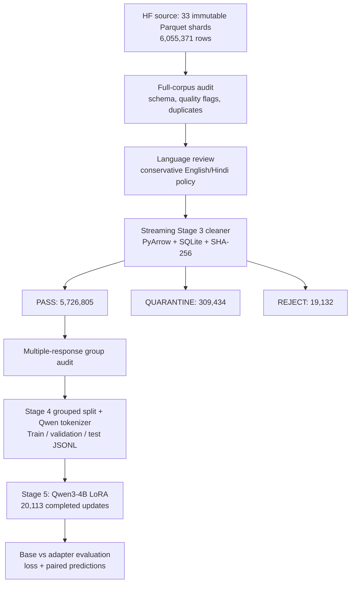

# LegalBrain AI

### From 6 million raw legal Q&A records to a reproducible LLM fine-tuning pipeline

**Python 3.13 · Qwen3-4B · LoRA / MLX-LM · PyArrow · SQLite · FastAPI · Gradio**

LegalBrain AI is an **experimental Indian legal question-answering chatbot** built to demonstrate the full applied LLM engineering lifecycle: auditing a large raw dataset, designing a conservative cleaning policy, maintaining source provenance, preventing train/test leakage, fine-tuning a 4B-parameter model, and evaluating what actually changed.

**The centerpiece is the data pipeline.** It processed **6,055,371 records across 33 Parquet shards** into **5,726,805 policy-eligible Q&A examples** with deterministic outcomes, checksums, and traceable exports. The project also completed a substantial **20,113-step LoRA training run** on Apple Silicon, reducing validation *token-prediction loss* by **55.9%**. Whether the model became *more legally correct* is a separate question—and one the evaluations could not conclusively answer.

> **Project status:** Data engineering and Stage 4 export complete; local LoRA training and independent small-sample comparison completed. The planned ~100,000-example training experiment was stopped after the first ~20,000-example chunk within the available compute and time budget on a 16 GB MacBook Air. **This is not a production legal-advice system.**

## At a glance

| Achievement | Verified result |
|---|---:|
| Immutable full-corpus audit | **6,055,371** rows; **33/33** shards |
| Stage 3: PASS / QUARANTINE / REJECT | **5,726,805 / 309,434 / 19,132** |
| Peak memory during Stage 3 | **~637 MiB RSS**, using disk-backed SQLite |
| Stage 4 question-group-safe export | **5,726,805** valid chat records |
| Normalized question groups crossing splits | **0** |
| Multiple-answer question groups investigated | **17,967** in Stage 3 PASS |
| Completed full-size local LoRA chunk | **20,113 optimizer updates** |
| Validation token loss (same sample) | **3.681 → 1.6221** (**55.9% lower**) |
| 30-question reference unigram overlap F1 | **0.223 base → 0.405 adapter** (not legal accuracy) |

## Architecture and data flow



## Raw data source

The **sole raw dataset used for fine-tuning** was [Prarabdha / indian-legal-supervised-fine-tuning-data](https://huggingface.co/datasets/Prarabdha/indian-legal-supervised-fine-tuning-data) on Hugging Face.

- **Pinned revision:** [`fe58e87d8393ddd0b8e4224e3eec086c37f1f78e`](https://huggingface.co/datasets/Prarabdha/indian-legal-supervised-fine-tuning-data/tree/fe58e87d8393ddd0b8e4224e3eec086c37f1f78e)
- **Files:** 33 `train-00000-of-00033.parquet` … `train-00032-of-00033.parquet` shards.
- **Source fields:** `context`, `question`, `response`.
- **License shown by source dataset card:** Apache-2.0. Check the upstream card, provenance and terms before redistributing raw content.
- **Important limitation:** This third-party corpus is **not** an independently verified collection of authoritative legal judgments or correct answers. The project did not validate each answer against primary legal sources.

Raw Parquet and generated datasets are **never committed to Git**.

## Data cleaning: the main engineering challenge

### 1 — Read-only, full-corpus audit

Before discarding any record, the audit measured missing fields, suspicious text, candidate placeholders, reference-number gaps, text lengths, language predictions and duplicate fingerprints across **all 6,055,371 rows**. The audit does **not** modify the source and does **not** treat every heuristic flag as a confirmed defect.

| Audit signal | Count | Why this is a *review signal* |
|---|---:|---|
| Missing question | 17,123 | Cannot form a question-only pair |
| Potentially context-dependent question | 214,273 | May need unseen court-document context |
| Statement-like question | 24,331 | May not be an actionable question |
| Short response | 146,921 | A date, money amount, or short statute answer can be valid |
| Placeholder response | 11,459 | May provide no useful supervision |
| Possible missing legal-reference number | 422,913 | Heuristic; many matches occur in `context` |
| Redundant normalized full-record duplicates | 2,990 | Could over-weight repeated examples |

**Nuance matters.** A form-feed (`\f`) often indicates a page break from a PDF judgment, not corruption; the audit therefore tracks it separately. Replacement characters (`U+FFFD`) and suspicious control characters are flagged rather than “repaired” by inventing missing legal text. These counts can overlap and **must not be added** as though they represent unique bad records.

### 2 — English/Hindi validation without pretending classifier scores are probabilities

Language was classified **separately for the question and answer** using `langid`. An evaluation workflow used a 500-record review pilot: **400 probability-sampled core cases + 100 targeted edge cases**, with AI-assisted labels subsequently inspected/confirmed by the user. This is **not** independent double-human annotation.

The classifier sometimes mislabeled short legal strings, names, Romanized Hindi and case captions. Its raw scores are **not calibrated probabilities**; the pilot did not justify robust production score thresholds. Instead, V1 deliberately uses a conservative **label-based operational gate**:

- Same-language `en/en` or `hi/hi` pairs are *language-eligible* if other checks pass.
- Cross-language, unsupported-prediction, mixed or uncertain labels, unknown or invalid cases are **quarantined** for review. The classifier does not reliably detect every mixed-language case.
- An unsupported **prediction never causes automatic REJECT**. Language predictions are evidence, not ground truth.

The goal was a reproducible, auditable screening policy—not a false claim of perfect multilingual classification.

### 3 — Deterministic Stage 3 cleaning at 6-million-row scale

The cleaner streams bounded **PyArrow batches**, reuses audit indicators and maintains a **disk-backed SQLite fingerprint index** for corpus-wide exact normalized-record deduplication. Comparison fingerprints use Unicode NFC plus collapsed whitespace, without rewriting original question/answer text.

Every source row receives **exactly one** final status (with primary and secondary machine-readable reasons):

| Stage 3 outcome | Rule | Records |
|---|---|---:|
| **REJECT** | Missing/blank required field, or redundant full-record duplicate occurrence | **19,132** |
| **QUARANTINE** | Unresolved language, placeholder, source-dependence, integrity or other required-review signal | **309,434** |
| **PASS** | Satisfies approved deterministic checks and remains eligible for export | **5,726,805** |
| **TOTAL** | All outcomes reconcile with the raw row count | **6,055,371** |

The rule precedence is **REJECT → QUARANTINE → PASS**. Multiple overlapping warning signals are preserved even though the row has one final outcome. Short answers, context-only reference gaps and normal page breaks are **not automatically rejected**.

**Integrity and scalability safeguards:**

- Original 33 Parquet shards stayed immutable; before/after SHA-256 checks matched.
- Original question and answer hashes showed **zero unexpected mutations**.
- The complete output includes outcome-partitioned Parquet, a compressed provenance ledger, deterministic canonical duplicate links, source manifests, and reconciliation reports.
- Peak resident memory was **~637 MiB** despite processing more than six million rows.
- The `PASS` label means *policy eligible*, **not independently legally correct**.

Read the [full Stage 3 cleaning policy](scripts/data_pipeline/clean/CLEANING_POLICY.md) and [data pipeline deep dive](docs/DATA_PIPELINE.md).

### 4 — Multiple-answer questions: don't guess which answer is correct

After Stage 3, **5,690,343 normalized question groups** remained. Among them, **17,967 groups** had more than one distinct normalized response, covering **49,052 records** and **46,065 response variants**.

The project created a complete machine-readable group audit and a 100-group review worksheet. It **did not** silently discard alternatives or assert that textually different answers were legal contradictions. Instead, every response variant was retained and **all records from a question group stayed in the same split**.

### 5 — Stage 4: leakage-aware dataset export

Stage 4 used the actual Qwen3-4B tokenizer and chat template to create valid question-only conversational JSONL. `context` was used for audit and source tracing, **not included in the user prompt**.

| Split | Records | Question groups | Multiple-response groups |
|---|---:|---:|---:|
| Train | **5,154,546** | 5,121,629 | 16,140 |
| Validation | **286,251** | 284,432 | 919 |
| Test | **286,008** | 284,282 | 908 |

- Split seed `20261031`; **zero normalized question groups crossing splits**.
- Token-length **P99 = 229**, recommended pilot maximum **1,024**; **112 records** above that recommendation were **retained without silent truncation**.
- No example exceeded the model's configured **40,960-token** context.
- Verified every JSONL row, source ID, manifest and split count against the Stage 3 PASS pool.

Grouping exact normalized questions prevents that leakage class; it **does not guarantee** semantic paraphrases or related judgments cannot appear across splits.

## Model training and honest evaluation

Fine-tuning used **Qwen3-4B + LoRA on an M4 MacBook Air (16 GB)** through MLX-LM, with masked assistant-only loss, checkpointing and repeatable base-model comparisons. The completed substantive experiment trained on **20,000 question groups / 20,113 QA records**, using Adam, one trainable layer, batch size 1, learning rate `5e-6`, gradient checkpointing and a 1,024-token limit.

| Measure | Base | LoRA adapter |
|---|---:|---:|
| Validation *token* loss (same 1,015 records) | **3.681** | **1.6221** |
| 30-question reference unigram overlap F1 | **0.223** | **0.405** |
| Exact match to the single reference | **0/30** | **1/30** |
| Median response length | **172 words** | **53 words** |

The independent small test showed **more overlap and much shorter answers**. But lower loss and word overlap are **not** verified legal accuracy. Preliminary review flagged possible unsupported case-specific dates and deadlines; the 30-question evaluation has not received independent human legal review. An earlier 100-question, 50-step pilot found no statistically meaningful answer-quality advantage.

### Resource constraints and the unfinished research question

**The engineering pipeline succeeded; provable factual-answer improvement did not.** A five-chunk, ~100,000-example training plan was prepared, but the first **20,113-update** chunk was the only one trained. The full first chunk required sustained local compute on a **16 GB laptop**; the remaining chunks were not run within the available compute budget. Thermal readings were unavailable during the final inference run, so no measured overheating is claimed.

More compute **might** help model adaptation, but is not a guaranteed solution to source-dependent prompts, conflicting/unverified references or hallucination. Further progress would require stronger legal-source validation, independent human review, possibly retrieval/citations, and additional GPU capacity.

See [Training & Evaluation](docs/TRAINING_AND_EVALUATION.md) for exact experimental details and limits.

## Tech stack

| Layer | Technologies |
|---|---|
| Data engineering | **Python 3.13**, PyArrow / Parquet, SQLite, `langid`, SHA-256, JSONL |
| Model & training | **Qwen3-4B**, Hugging Face tokenizer, MLX-LM, LoRA, Apple Silicon GPU |
| Backend | **FastAPI**, Pydantic, Uvicorn, bounded response cache, prompt guardrails |
| Frontend | **Gradio**, HTTPX |
| Workflow & quality | `uv`, Git / GitHub, Python `unittest`, reproducible reports and seeds |

**This is question-only SFT, not RAG.** The application does not retrieve live court decisions or changing legislation at inference time.

## Repository layout

```text
app/                       FastAPI server, guardrails, response cache, Gradio UI
scripts/data_pipeline/
  audit/                   Corpus inspection, language review, multi-answer audit
  clean/                   Stage 3 cleaning rules and streaming runner
  export/                  Stage 4 grouped splits, token analysis and JSONL
scripts/evaluate_model.py  Base-versus-adapter evaluation helper
tests/                     Pipeline and application unit tests
docs/                      Pipeline, training, reproducibility and structure
data/                      Local-only input and generated datasets (ignored)
outputs/                   Local-only adapters, predictions and logs (ignored)
```

## Run the chatbot on Apple Silicon

```bash
git clone https://github.com/prakharsri21/LegalBrain_AI.git
cd LegalBrain_AI
uv sync

# Terminal 1: base model (no uncommitted adapter required)
LEGALBRAIN_ADAPTER_PATH=base uv run uvicorn app.main:app --host 127.0.0.1 --port 8000

# Terminal 2
uv run python app/ui.py
```

Open [http://127.0.0.1:7860](http://127.0.0.1:7860), or explore API docs at [http://127.0.0.1:8000/docs](http://127.0.0.1:8000/docs).

To use the **completed local adapter**, set `LEGALBRAIN_ADAPTER_PATH=outputs/legalbrain-qwen3-4b-stage5-100k-v1-base-chunk01` **only if that ignored directory exists locally**. Models may require an initial download; MLX runs on compatible Apple Silicon hardware.

See [Reproducibility](docs/REPRODUCIBILITY.md) for pipeline entry points and [Project Structure](docs/PROJECT_STRUCTURE.md) for local artifact conventions.

## Next improvements, given more resources

1. Extend training on a larger GPU, with controlled checkpoint comparisons and general-capability retention tests.
2. Create an independently verified legal benchmark and assess unsupported citations, statutes, dates and amounts.
3. Review conflicting answer variants and semantic near-duplicates, not just exact normalized questions.
4. Add provenance-backed retrieval and citations for case-specific or changing information.
5. Evaluate human preference and factual correctness separately from token loss and lexical overlap.

---

**Disclaimer:** LegalBrain AI is a research/portfolio demonstration, not legal advice. The model can make mistakes, invent details or rely on outdated information. Verify claims against current authoritative sources and seek qualified advice for real legal decisions.
